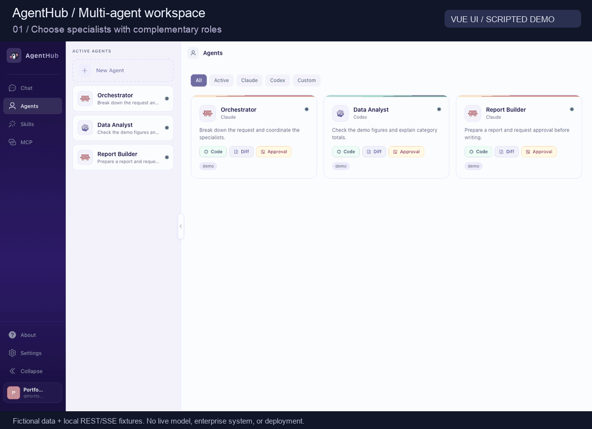
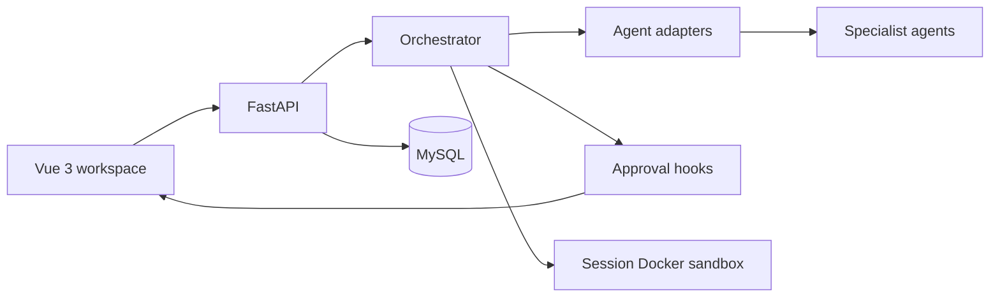

# AgentHub — Multi-Agent Collaboration Platform

**一个用聊天界面组织多智能体协作、展示执行过程并让用户审批关键操作的平台。**

AgentHub turns a natural-language request into coordinated work across specialist agents. Users can follow streamed responses, inspect tool calls and file changes, approve sensitive actions, and review the resulting artifacts in one workspace.

This is Yuxuan Feng's portfolio fork of [SeiyunSky/AgentHub-AllInOne](https://github.com/SeiyunSky/AgentHub-AllInOne). The platform is a team project; the original architecture report and contributor attribution remain in [ARCHITECTURE.md](ARCHITECTURE.md).

## Animated demo

**从一个任务到可预览的报告：多 Agent 协作、流式回复、人工审批与文件预览。**



This 21-second walkthrough records the actual Vue interface: an Orchestrator coordinates a Data Analyst and a Report Builder, the user reviews and approves a proposed HTML file, and the report opens in the workspace. It highlights how the interface makes agent activity and user decisions visible.

**Demo scope:** agent responses, tool events and report contents are scripted through local REST/SSE fixtures using fictional figures. The clicks, streamed rendering, approval request and sandboxed preview use the real frontend; this recording does not run a live model, enterprise integration or deployment.

[Reproduce the recording and inspect its checks](docs/DEMO.md) · [Approval screenshot](docs/media/agenthub-approval.png) · [Report screenshot](docs/media/agenthub-report.png)

## Product walkthrough

1. Create a conversation and choose agents or a group template.
2. Submit a task; the orchestrator decomposes it and delegates work.
3. Follow streamed agent responses and tool activity.
4. Inspect proposed changes and approve or reject operations that require review.
5. Review generated files, workflow traces and application previews.

### Agent workspace


### Review a change before execution


These are existing runtime screenshots from the upstream team's documentation. They illustrate the shared platform, rather than claiming every pictured feature as an individual contribution.

## What the platform demonstrates

| Capability | Implementation and interview discussion |
| --- | --- |
| Agent orchestration | An orchestrator coordinates specialist agents, tool calls and task dependencies across multiple conversation modes. |
| Human oversight | Approval hooks pause relevant tool operations while the interface presents the proposed action and decision controls. |
| Real-time applications | Vue 3 and FastAPI coordinate streamed content through SSE, with WebSocket signaling for interactive operations. |
| Agent interoperability | Adapter and MCP integration points connect different agent backends. |
| Developer experience | Workflow traces, file previews and sandboxed execution help users understand and inspect outputs. |

## My contribution during the SAP internship

My work focused on message-operation APIs and editing, real-time approval notifications and the approval flow, enterprise-agent integration, and long-conversation reliability. Specific integration work connected a bank-relationship assistant through MCP/BTP Destination and a margin-analysis assistant through A2A. I also investigated broken `tool_use` / `tool_result` pairing after context compression, which caused API 400 errors.

These contributions demonstrate API implementation, asynchronous interaction design, protocol integration, and debugging across an agent's conversation lifecycle. The team project received first place in the SAP STAR Intern AI Showcase.

The public fork includes the shared platform and upstream development. Enterprise service configuration, credentials and SAP business data are not a prerequisite for browsing this portfolio, and are not supplied here.

## Architecture at a glance



## Run and explore

Clone this fork, then follow the existing [local development guide](All_Things_YOU_NEED_TO_KNOW/本地开发配置.md). It documents the backend, frontend, database, model-provider configuration and platform-specific setup. Model execution requires your own configured provider or CLI credentials.

```bash
git clone https://github.com/yf2685-beep/agenthub-multi-agent-platform.git
cd agenthub-multi-agent-platform
```

| Start here | Purpose |
| --- | --- |
| [Local setup](All_Things_YOU_NEED_TO_KNOW/本地开发配置.md) | Prerequisites, configuration and startup |
| [Architecture and original contributions](ARCHITECTURE.md) | Orchestrator loop, streaming, approvals, adapters and team attribution |
| [Backend](backend/) | APIs, services and agent integration |
| [Frontend](frontend/) | Vue workspace and interaction components |
| [Runtime](runtime/README.md) | Container runtime documentation |

## Attribution

AgentHub was developed collaboratively. This fork presents the project and my contribution for portfolio review; it preserves the upstream authorship, source history and licensing terms.
